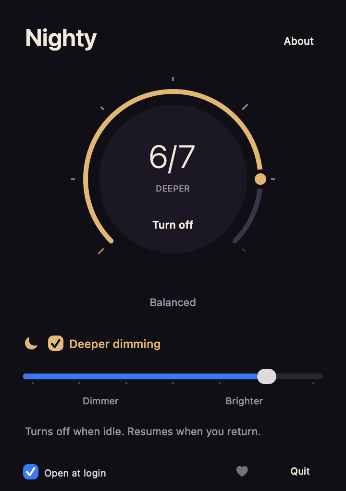

# Nighty Keyboard

A native macOS menu bar app for keyboard brightness. Swift, AppKit, and MIT licensed.

<p align="center">
  
</p>

## Features

- Brightness dial, arrow-key navigation, and Low, Work, and Bright presets.
- Continuous deeper dimming with Deeper, Balanced, and Gentler settings.
- Restore previous settings, keep current macOS settings, or turn the light off.
- Open at login on macOS 13+.

Free, with no time limit, accounts, analytics, or keyboard-input monitoring.
Deeper dimming is experimental; physical brightness and flicker are not measured.

## Build and use

Requires Apple Command Line Tools.

```sh
./scripts/test.sh
./scripts/build.sh
open "build/Nighty Keyboard.app"
```

Click the menu bar dial and drag its rim or choose a preset. **Enable deeper
dimming** runs with the panel closed. **Stop deeper dimming**, **Use macOS**, and
**Off** end it. Sleep, idle, macOS changes, and command or timing failures also
stop the mode; it does not restart automatically after sleep.

```sh
./scripts/package.sh
```

Packages are written to `build/`. Quit the previous copy, then drag the app from
the DMG into Applications.

## Compatibility

| Architecture | Minimum macOS build target |
| --- | --- |
| Apple Silicon · arm64 | 11.0 |
| Intel · x86_64 | 13.0 |

Requires a built-in backlit keyboard and Apple's private CoreBrightness interface.
Intel and older macOS targets need hardware validation. Packages are ad hoc signed,
not notarized.

## Codebase

```text
Sources/
├── App/
│   ├── main.swift                  Lifecycle, menu bar, timers, and CLI
│   ├── Panel.swift                 Dial, presets, and recovery UI
│   ├── BrightnessController.swift  Steady brightness and settings ownership
│   ├── DeepDimmingSession.swift    Fade scheduling and depth settings
│   ├── NativeDevice.swift          Keyboard adapter and recovery storage
│   ├── NativePWM.swift             Raw HID adapter and diagnostics
│   └── PWMSession.swift            Raw-report session and recovery
└── Hardware/
    ├── KeyboardBridge.h/.m         CoreBrightness runtime boundary
    └── PWMBridge.h/.m              HID discovery and readback guards
Tests/                              Device-free regression checks
Resources/                          App metadata and icon
scripts/                            Build, test, package, and icon generation
tools/                              Diagnostics and manual repair utilities
docs/                               Architecture, development, and preview
```

## Recovery

**Restore saved settings** waits for macOS confirmation and retains the record
on failure. A nonzero restore can clear macOS's idle-dim state. **Keep current
macOS settings** clears recovery without a hardware write when the sensor
preference already matches. Records are stored in
`~/Library/Application Support/Nighty Keyboard/`.

[Architecture](docs/ARCHITECTURE.md) · [Development](docs/DEVELOPMENT.md) ·
[Changelog](CHANGELOG.md) · [MIT license](LICENSE)
