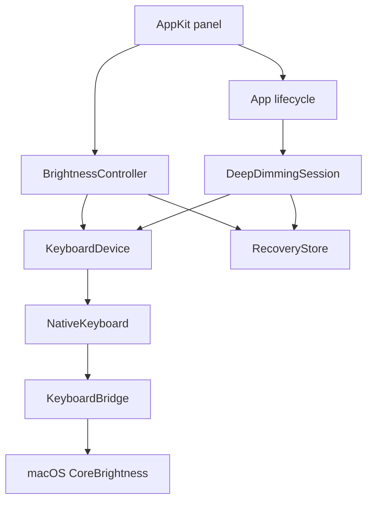

# Architecture

Nighty separates the native interface, brightness state, and macOS hardware access.
The app and session controllers run on the main thread. Small Objective-C bridges
validate private runtime interfaces before Swift calls them.

## Control flow

`main.swift` connects a built-in keyboard, owns the menu bar item and popover,
and schedules observation, selection verification, and fade ticks. It coordinates
sleep, screen locking, wake, and termination. Launch reads the keyboard and stages
any saved recovery record for an explicit user choice.

`Panel.swift` presents the dial, presets, depth controls, and recovery actions.
Dragging previews a selection locally and sends a command only on release.
Accessibility increment/decrement actions follow the same selection path.

## Steady brightness

`BrightnessController` owns the original settings snapshot, selected dial index,
observed brightness, verification state, and user-facing status.

Before the first write it saves the keyboard ID, brightness, and automatic-brightness
preference. It then disables automatic brightness as needed and sends one request
for the selection. A delayed readback distinguishes an accepted command from a
confirmed logical setting. Observation releases control when macOS changes the
level rather than continuously forcing the selection back.

The scale contains Off, eight low requests, and sixteen regular requests. These
are logical values, not measured light intensity or PWM duty cycles.

## Deeper dimming

`DeepDimmingSession` repeatedly retargets hardware-managed fades between Off and
a near-minimum nonzero request. It uses a linear-ramp model with three envelopes:

| Setting | Nominal lower bound | Nominal upper bound |
| --- | --- | --- |
| Deeper | 0.15 | 0.35 |
| Balanced | 0.25 | 0.45 |
| Gentler | 0.45 | 0.65 |

These fractions describe the scheduling model; they are not calibrated optical
measurements. There is no runtime expiry or payment gate.

The session checks logical target readback and stops on rejected commands,
late scheduling, macOS changes, or idle/sleep. It never catches up by issuing a
burst of stale commands. Suppression at the session's intentional Off endpoint
is allowed; genuine idle and sleep still stop it. Changing depth preserves the
original recovery snapshot and restarts the ramp model.

The firmware's interpolation, physical minimum, and flicker remain unverified.
The fake-device tests validate scheduling and ownership, not emitted light.

## Recovery and handoff

`RecoveryStore` writes `keyboard-session.json` atomically in the app's Application
Support directory. Failure to save prevents the initial hardware write.

Restoration checks the saved keyboard ID and attempts the original brightness and
sensor preference. Accepted changes can receive a delayed confirmation; a failed
confirmation keeps the recovery record. Explicit nonzero restoration may clear
macOS's idle-dim flag before making the normal brightness request. The fade loop
and sleep handlers do not invoke that repair.

Keeping current macOS settings is a separate, explicit action. It clears recovery
without hardware writes only when the current sensor preference matches and no
legacy idle-suspension restoration is pending. Writer connections are released
when returning control, including failure paths.

## Hardware boundary

`KeyboardBridge` dynamically loads CoreBrightness and checks selector argument
and return types. Normal selections use the manual-brightness property; deeper
dimming uses a dictionary containing brightness, fade duration, and commit state.

`PWMBridge` is a separate guarded HID interface. It requires a recognized descriptor
and independent firmware readback before attempting a raw report. `PWMSession`
preserves and verifies that raw baseline. The regular app does not use this path
for deeper dimming, and no PWM frequency control is exposed.

## Verification

`Tests/ControllerTests.swift` uses fake keyboard and HID devices to exercise
ownership, recovery, delayed readback, ignored writes, suppression, sleep, and
continuous fade scheduling. `--verify-ui` checks panel bounds, accessibility,
presets, depth controls, recovery, Off, and Use macOS with a fake keyboard.
Neither check establishes physical brightness or flicker behavior.
