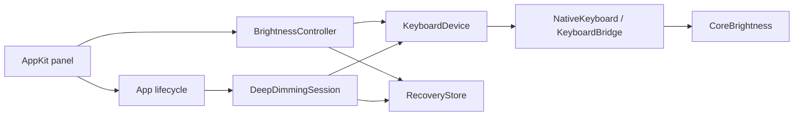

# Architecture

Controllers run on the main thread. Swift owns UI and state; Objective-C bridges
validate runtime signatures and call macOS interfaces.

## Steady brightness

`BrightnessController` saves the keyboard ID, brightness, and automatic-brightness
preference before the first write. It sends one command per selection, checks
readback, and releases control when macOS changes the level. The dial contains
Off, eight low requests, and sixteen regular requests.

`Panel.swift` commits a drag on release. `main.swift` coordinates connection,
observation, verification, fade ticks, sleep, locking, wake, and termination.

## Deeper dimming

`DeepDimmingSession` retargets hardware fades between Off and a near-minimum
request. Its linear-ramp model uses these targets:

| Level | Setting | Target fraction |
| --- | --- | --- |
| 1 | Barely lit | 0.04 |
| 2 | Very low | 0.06 |
| 3 | Low | 0.10 |
| 4 | Dim | 0.16 |
| 5 | Deeper | 0.25 |
| 6 | Balanced | 0.50 |
| 7 | Gentler | 0.75 |

Fractions are model values, not measured PWM duty or light output. The envelope
half-width is max(0.0006, target × 0.003). Hold fades adapt between 10–60 seconds;
initial and level-change transitions use four seconds.

One-shot timers follow readback and fade deadlines, with status checks scheduled
every 500 ms. Normal observation pauses during deeper mode. Retargeting accounts
for elapsed time and preserves the current ramp when switching depth. Rejected
commands and excessive drift stop the session; macOS changes hand back control,
and idle/sleep pause it.
Intentional Off suppression is allowed; stale commands are never replayed.

## Idle, sleep, and preferences

`LightingMemory` stores a versioned desired mode, both selected levels, and a
clean-shutdown marker. These preferences are separate from the original macOS
recovery snapshot. New installs start under macOS control until a mode is enabled.

`NativeActivity` reads aggregate `HIDIdleTime`, the macOS keyboard timeout and idle
flag, and lock/display/lid state. No input events or key contents are recorded.
Active status is cached for 500 ms. Paused activity checks run every two seconds;
system sleep cancels them. A wake retries readiness every 500 ms for ten seconds,
then leaves the level pending for ordinary activity checks.

Idle pauses ownership without restoring the sensor or overwriting the original
brightness with zero. Activity resumes the same snapshot and desired level only
after macOS releases idle suppression. Independent sleep/display/lock reasons
prevent early resume. Level changes while paused update the saved preference.

A clean relaunch may resume preferences or an owned paused snapshot; startup marks
the session unclean before any hardware writes. Explicit handoff disables resume.
Quit returns original settings, or just the sensor while asleep; clean exit is
recorded only when that cleanup is confirmed. Crashes, unknown data, unavailable
activity metadata, and failed preference writes never silently restart lighting.

## Recovery

`RecoveryStore` atomically saves `keyboard-session.json` in Application Support.
A failed save prevents the first hardware write. Restore checks device identity,
attempts brightness and sensor restoration, and retains the record until readback
confirms it. Accepted changes can receive delayed confirmation.

Explicit nonzero restoration may clear macOS's idle-dim flag. Fade and sleep
handlers do not invoke that repair. Keeping current settings clears recovery
without writes only when the sensor preference matches and no legacy idle-suspension
restore is pending. Handoff and failure paths release writer connections.

## Raw HID

`PWMBridge` requires a recognized descriptor and independent firmware readback
before attempting a raw report. `PWMSession` saves and verifies that baseline.
The app's deeper mode uses CoreBrightness, not raw HID or PWM frequency control.
