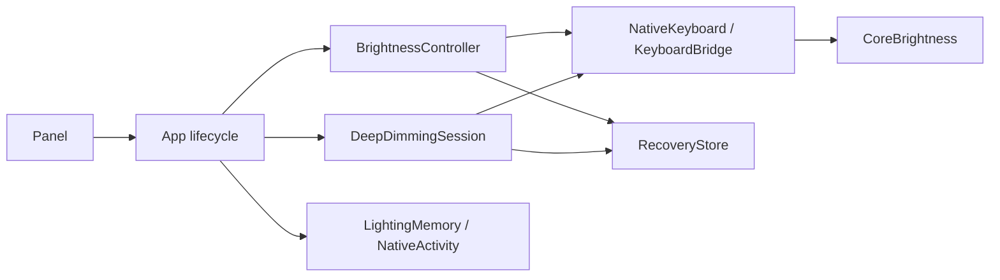

# Architecture

Swift/AppKit owns state on the main thread. Objective-C bridges validate runtime
signatures before calling private macOS interfaces.

## Brightness

Steady mode sends one command per selection and verifies readback. The scale has
Off, eight low requests, and sixteen regular requests. Dial drags commit on release.
External macOS changes release Nighty’s control.

Deeper mode retargets fades between zero and a near-minimum request. Seven modeled
fractions are 0.04, 0.06, 0.10, 0.16, 0.25, 0.50, and 0.75. These are not measured
light output or PWM duty. Envelope half-width is `max(0.0006, target × 0.003)`;
hold fades last 10–60 seconds. Startup fades to zero first; level transitions
reach the modeled envelope in about 350 ms.

One-shot timers follow fade/readback deadlines. Status checks run every 500 ms.
Retargeting accounts for elapsed time; rejected commands and excessive drift stop
the session. Steady/deeper transfers retain the original recovery record.
Off cancels deeper scheduling and sends zero with no fade duration, without first
restoring a brighter level. The UI shows the selected Off state while readback verifies it.

## Activity and persistence

`NativeActivity` reads aggregate HID idle age, the macOS timeout and idle flag,
and lock/display/lid state. It records no input contents. Readiness checks run
every 500 ms; system sleep cancels timers. Wake retries last ten seconds before
ordinary activity checks continue.

`LightingMemory` stores desired mode, levels, and a clean-exit marker separately
from the original macOS snapshot. Idle/sleep retain that snapshot. Resume requires
activity and macOS readiness. Explicit Off/handoff disable resume. Unclean exits,
invalid records, and failed preference writes require explicit recovery.

## Handoff and recovery

The menu’s macOS action restores the baseline, requests the first regular level
(1/16), verifies it, and releases control with the original sensor preference.
Quit restores original settings; during idle/sleep it returns sensor control and
retains the brightness record for later recovery.

`RecoveryStore` saves `keyboard-session.json` atomically in Application Support.
A failed initial save prevents writes. Restore checks keyboard identity and keeps
the record until brightness and sensor readback confirm success. Explicit nonzero
restoration may clear the idle-dim flag; fade and sleep handlers never do so.

## Raw HID

`PWMBridge` requires a recognized descriptor and firmware readback before writes.
`PWMSession` retains the verified baseline. Deeper mode uses CoreBrightness;
it does not control raw HID or PWM frequency.
