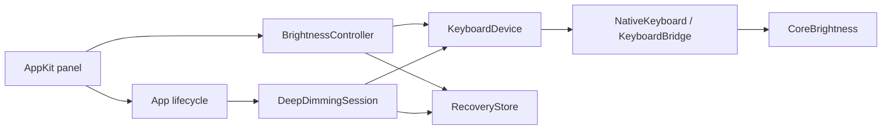

# Architecture

Controllers run on the main thread. Swift owns UI and state; Objective-C bridges
validate runtime signatures and call macOS interfaces.

## Steady brightness

`BrightnessController` saves the keyboard ID, brightness, and automatic-brightness
preference before the first write. It sends one command per selection, checks
readback, and releases control when macOS changes the level. The dial contains
Off, eight low requests, and sixteen regular requests.

`Panel.swift` commits a drag on release. `main.swift` coordinates connection,
observation, verification, fade ticks, sleep, locking, wake, and termination.

## Deeper dimming

`DeepDimmingSession` retargets ten-second hardware fades between Off and a
near-minimum nonzero request. Its linear-ramp model uses these envelopes:

| Setting | Lower | Upper |
| --- | --- | --- |
| Deeper | 0.245 | 0.255 |
| Balanced | 0.495 | 0.505 |
| Gentler | 0.745 | 0.755 |

Fractions are model values, not measured PWM duty or light output. Retarget timing
uses actual elapsed time. Depth changes continue from the current estimate without
restarting from Off. Logical readback checks commands; rejected commands, late
scheduling, macOS changes, and idle/sleep stop the session. Intentional Off
suppression is allowed. No catch-up bursts or runtime expiry are used.

## Recovery

`RecoveryStore` atomically saves `keyboard-session.json` in Application Support.
A failed save prevents the first hardware write. Restore checks device identity,
attempts brightness and sensor restoration, and retains the record until readback
confirms it. Accepted changes can receive delayed confirmation.

Explicit nonzero restoration may clear macOS's idle-dim flag. Fade and sleep
handlers do not invoke that repair. Keeping current settings clears recovery
without writes only when the sensor preference matches and no legacy idle-suspension
restore is pending. Handoff and failure paths release writer connections.

## Raw HID

`PWMBridge` requires a recognized descriptor and independent firmware readback
before attempting a raw report. `PWMSession` saves and verifies that baseline.
The app's deeper mode uses CoreBrightness, not raw HID or PWM frequency control.
